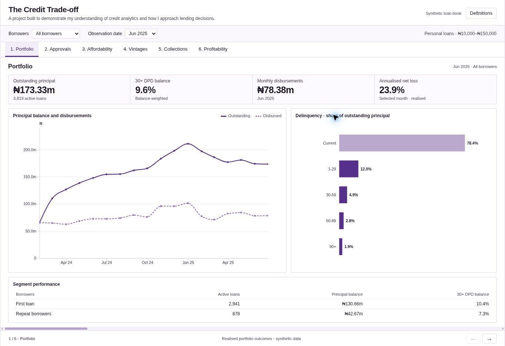

# The Credit Trade-off

[Open the dashboard](https://codeventurer144.github.io/the-credit-trade-off/)

I built this project to look at what happens when a lender tries to approve more loans. Getting the approval numbers up is one part. The loans still need to be affordable for the borrower, and the business needs to cover its losses and costs.

The dashboard follows that decision from the application stage through to repayments, collections and profitability. It uses D3.js, with SQL and Python behind the analysis.

### What you can explore

- **Portfolio:** loan balances, disbursements and overdue repayments.
- **Approvals:** move the score cut-off and see how approvals and expected losses change.
- **Affordability:** adjust the repayment ceiling and inspect individual applications.
- **Vintages:** compare loans issued in different months at the same age.
- **Collections:** compare two collection treatments, including their results and costs.
- **Profitability:** see what is left after credit losses, funding and operating costs.

The three policy workspaces share the same proposal, so a change in one carries into the others. The dashboard moves horizontally between the six views.

One result I found interesting was that lowering the score cut-off from 640 to 620 raised approvals from about 54% to 63%, but made the expected contribution worse under the assumptions used. More lending did not automatically mean a better outcome.

### The data and calculations

The data is synthetic: 50,000 applications and 22,404 funded loans. It was generated so that applications, repayment schedules and actual payments can be followed through the whole loan lifecycle. It contains no Kuda customer data, and the product rules and costs are project assumptions.

The CSV tables are stored compressed in `data/`. Running `python src/unpack_data.py` restores the original files.

I have kept the workings in [calculations.md](calculations.md), and explained my choices and the limits of the analysis in [thought-process.md](thought-process.md). The model also underestimates default in the later test period; those results are included.

To run it locally, download the project and open `index.html`. The dashboard assets are included, so it works offline too. The Python scripts and SQL queries are there for anyone who wants to reproduce the analysis.
